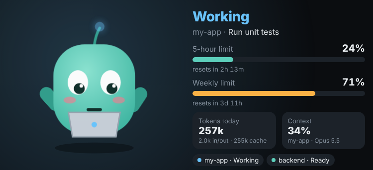
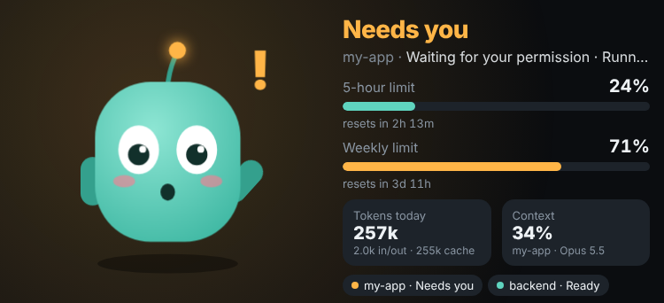
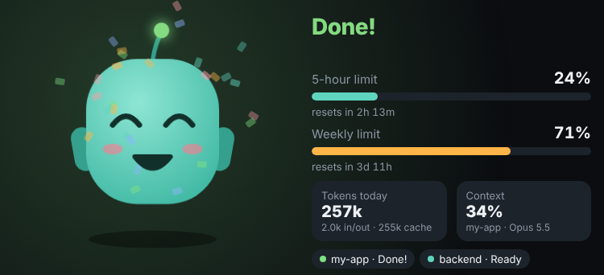
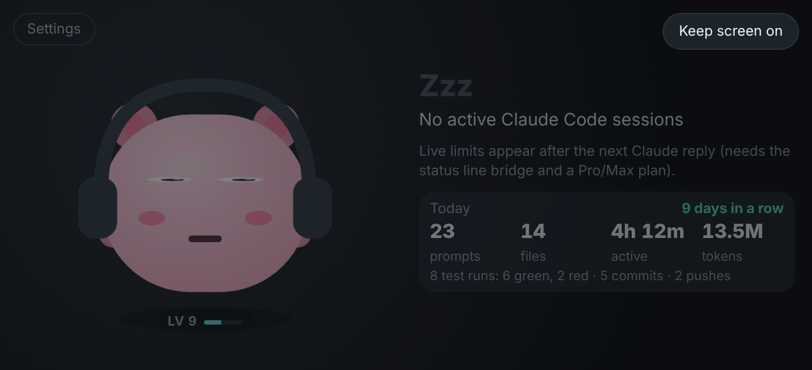
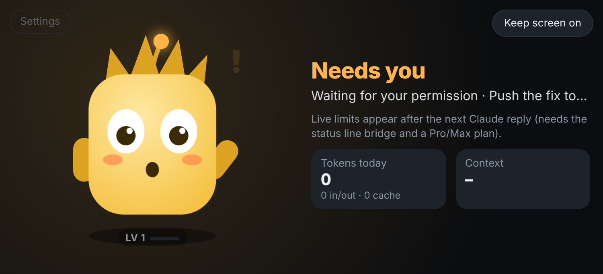
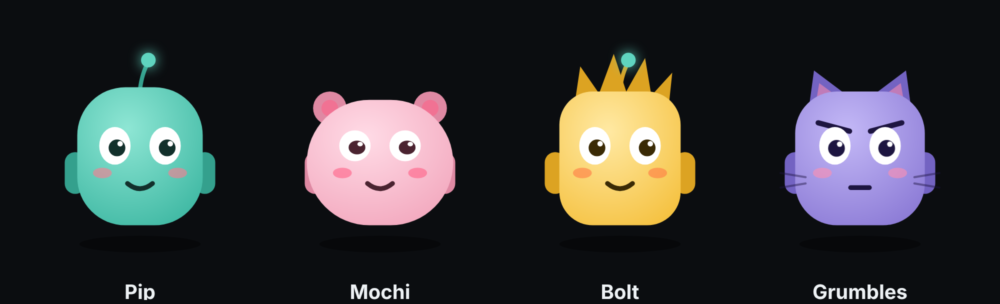
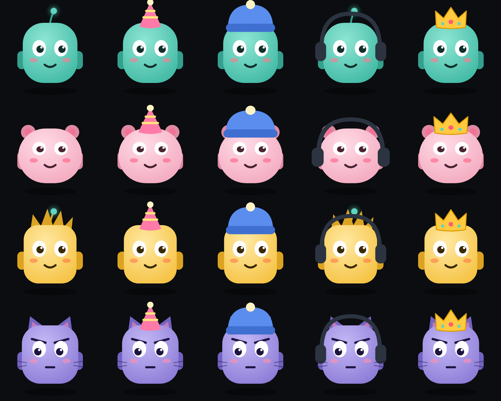

# Desk Buddy

A little desk companion for [Claude Code](https://code.claude.com). Put an old phone or tablet next to your computer and a friendly character shows what Claude is doing: thinking, editing files, running tests, waiting for your permission, done. It also shows your real subscription usage.



| Needs you | Done |
| --- | --- |
|  |  |

It is a small web app served from your own computer. No account, no cloud service, no API key. It works with the Claude Code subscription you already have.

## Features

- **Live mood** driven by Claude Code hooks: ready, thinking, working, *needs you*, done, error, asleep.
- **What Claude is doing right now**, for example "Editing ContentView.swift" or "Run unit tests".
- **Needs-you alert**: the screen turns amber and the buddy waves when Claude is waiting for a permission or an answer. You notice it even when the terminal is behind other windows.
- **Real 5-hour and weekly limits** with reset countdowns. These are the numbers Claude Code itself reports (the same as `/usage`), not estimates.
- **Tokens today** and **context window** use.
- **Several sessions at once**: the most urgent session decides the mood, and the rest are listed as chips.
- Works as a full-screen home-screen app on iPhone, keeps the screen awake, and is gentle on OLED screens.
- **Four buddies with their own personalities.** Pick one under *Settings* in the corner. Each has its own look, pace and lines.
- **Tap the buddy** and it reacts in character. Tap it a lot and it gets dizzy.
- **Reacts to what happens**: cheers when tests pass, slumps when they fail, spins on a commit, throws confetti on a push, and flinches at risky commands like `git push --force`, `git reset --hard` or `rm -rf ~`.
- **Chimes** (optional) when Claude needs you, finishes or hits an error, with a reminder after 1 and 3 minutes if you haven't looked. Each buddy has its own voice.
- **Today**: when nothing is running, a summary of the day replaces the token tiles: prompts, files edited, active time, tokens, test runs, commits, pushes and your streak of days in a row.
- **The buddy grows**: it levels up as you work, and earns hats on the way (a party hat, a beanie, headphones and a crown).
- **Black screen at night** (or whenever the buddy sleeps), with a small wandering clock. It lights up by itself when Claude starts working or needs you, and a tap peeks for a minute.
- **Approve from the phone** (optional): answer Claude's permission questions with *Allow* or *Deny* on the phone. See [below](#approve-from-the-phone-optional).
- **A QR code in the terminal**, so the phone just scans the link.
- English and Danish UI, picked from the phone's language.

| Today, while Claude rests | Approve from the phone |
| --- | --- |
|  |  |

## Meet the buddies



| Buddy | Personality | On a permission prompt |
| --- | --- | --- |
| **Pip** | Cheerful little helper | "Psst! I need you." |
| **Mochi** | Soft, sleepy and cozy. Moves slowly. | "Um… could you come here?" |
| **Bolt** | Way too much energy. Moves fast. | "HEY! Need a yes from you!" |
| **Grumbles** | Grumpy, but gets it done | "Your permission. Today, please." |

The buddy speaks up when the mood changes (always for *needs you*, *done* and *error*, at most every 12 seconds otherwise) and when you tap it. Your choice is remembered on the phone. You can also pick one in the link with `&buddy=mochi`.

## Requirements

- macOS, Linux or Windows with **Node.js 18+**
- A recent **Claude Code** (it needs HTTP hooks and `rate_limits` in the status line; tested with 2.1.325)
- A phone, tablet or any browser that can reach the computer, on the same Wi-Fi or over [Tailscale](https://tailscale.com)
- For the limit bars: a claude.ai subscription (Pro, Max). Everything else works on any plan.

## Try it first (demo mode)

Want to see it before touching your Claude Code settings? Demo mode plays a scripted session in a loop: prompts, file edits, a permission request, a subagent, a failing test, done. It needs no Claude Code and changes nothing on your machine.

```sh
npx github:NikolajMosbaek/desk-buddy demo
```

Open the printed link on your phone. A small **DEMO** badge shows that the data is made up.

## Quick start

On the computer where you run Claude Code:

```sh
npx github:NikolajMosbaek/desk-buddy install
npx github:NikolajMosbaek/desk-buddy
```

The first command adds the hooks to `~/.claude/settings.json` (a backup is saved first). The second starts the server and prints a link and a QR code like:

```
Open one of these on your phone (same Wi-Fi, or Tailscale):
  http://192.168.1.20:4317/?t=k3x9pqmw   (en0)
```

Then **restart your running Claude Code sessions** so they load the hooks.

Prefer a global install? `npm install -g github:NikolajMosbaek/desk-buddy` gives you a `desk-buddy` command.

## Setting up the phone (iPhone)

1. Scan the QR code in the terminal with the phone's camera, or open the printed link in Safari. If the QR code shows the wrong address (a VPN, Docker), use `--qr-host <ip>`.
2. Tap **Share > Add to Home Screen**. The buddy now opens full screen, without Safari's bars.
3. Put the phone on a charger and stand it up next to your screen. Landscape and portrait both work.
4. The app asks iOS to keep the screen on. If the screen still dims, tap **Keep screen on** once. For a phone that only does this job, **Settings > Display & Brightness > Auto-Lock > Never** is the most reliable option.

Android and tablets work the same way through the browser's "Install app" or "Add to Home screen".

## Keeping it running

The server has to run while you work. The simplest is a spare terminal tab. To start it automatically at login on macOS, install it globally and add a LaunchAgent:

```sh
npm install -g github:NikolajMosbaek/desk-buddy
cat > ~/Library/LaunchAgents/dev.desk-buddy.plist <<EOF
<?xml version="1.0" encoding="UTF-8"?>
<!DOCTYPE plist PUBLIC "-//Apple//DTD PLIST 1.0//EN" "http://www.apple.com/DTDs/PropertyList-1.0.dtd">
<plist version="1.0"><dict>
  <key>Label</key><string>dev.desk-buddy</string>
  <key>ProgramArguments</key><array>
    <string>$(which node)</string><string>$(which desk-buddy)</string>
  </array>
  <key>RunAtLoad</key><true/>
  <key>KeepAlive</key><true/>
</dict></plist>
EOF
launchctl load ~/Library/LaunchAgents/dev.desk-buddy.plist
```

If the server is not running, the hooks fail silently and Claude Code is not affected.

## Settings on the phone

Tap **Settings** in the corner. Everything is stored on the phone, so two phones can be set up differently.

- **Buddy**: who keeps you company.
- **Black screen**: never, at night (pick the hours), or whenever the buddy is asleep.
- **Sound**: off by default. iPhones only allow sound after a tap, so a small *Tap to enable sound* button shows until you do. Sound plays even with the ring/silent switch on, which is what you want from a desk gadget, and pauses other audio on that phone.
- **Reactions** to tests, commits and pushes, the **Today** summary, the **hat** and the **level** chip can each be turned off.
- **Approve from phone**: where the approval key goes.

Tests are recognised for the usual runners (`npm test`, `pnpm test`, `vitest`, `jest`, `pytest`, `go test`, `cargo test`, `swift test`, `xcodebuild test`, `gradle test` and more). A run counts as failed when the command fails or its output reports failures.

### Levels and hats

Experience comes from what you do: 1 per prompt, 2 per passing test run, 3 per commit, 5 per push and 10 per day you use Claude Code. Level *n* needs 25·(n−1)² experience, so the first levels come within days and later ones take weeks.



| Hat | Earned at |
| --- | --- |
| Party hat | Level 3 |
| Beanie | 3 days in a row |
| Headphones | 50 commits |
| Crown | Level 10 |

Counts are kept in `~/.desk-buddy/stats.json` on the computer, so the buddy keeps its level when you switch phones.

## Approve from the phone (optional)

Off by default. To answer permission questions on the phone:

```sh
desk-buddy approvals on            # prints an approval key, e.g. XB97-RZJK-RB23-2SKB
```

Type the key once on the phone under **Settings > Approve from phone**, and restart your Claude Code sessions. From then on, when Claude asks for permission while that phone is open, it shows the full command (or the file and the change) with **Allow** and **Deny**. If nobody answers within 20 seconds (`--wait N` to change it), the question goes back to the terminal as usual. Depending on your Claude Code version, the terminal prompt may only appear once that wait is over, which is why the default is short. Phones without the key, and other browsers with the link, never make a question wait.

Only shell commands, file edits and web fetches are sent to the phone. Questions from MCP tools, plan approvals and Claude's own multiple-choice questions always stay in the terminal, and so does anything too long to show in full.

How it is protected:
- The page link alone cannot approve anything. Every answer is signed with the approval key (HMAC-SHA256 over a random id per question and a digest of exactly what the phone showed). The key is typed on the phone and never sent over the network, so someone who sniffs the link on your Wi-Fi still can't approve, replay an answer, or move it to another command.
- Five wrong signatures in a minute pause approvals for a minute.
- The buttons wake up a moment after a question appears, so a tap meant for the buddy can't approve it.
- Web pages open on your computer can't post fake questions: hook requests from a browser are refused.
- What it doesn't protect against: the page is plain HTTP, so anyone on your network can see the commands Claude asks about, and someone who can tamper with your traffic could change the page itself. Use a network you trust, or Tailscale.

`desk-buddy approvals off` turns it off, and `desk-buddy approvals new-key` replaces the key.

## What `install` changes

Everything goes into `~/.claude/settings.json`. A timestamped backup is written next to it first, and your own hooks and settings are left alone.

1. **Hooks.** One HTTP hook per event (`UserPromptSubmit`, `PreToolUse`, `PostToolUse`, `PermissionRequest`, `Notification`, `Stop`, and a few more) that POSTs the event to `http://127.0.0.1:4317/hook`. The server replies straight away with a no-op, so the hooks never block or change what Claude does. The one exception is `PermissionRequest` with [approvals](#approve-from-the-phone-optional) turned on.
2. **Status line bridge.** Claude Code only exposes your limit percentages to status line scripts, so `install` adds a small script (`~/.desk-buddy/statusline.mjs`) that forwards that data to the server.
   - If you already have a status line, it is kept: the bridge runs your command and prints its output unchanged.
   - Without one, you get a compact line: `Opus 5.5 · ctx 34% · 5h 23% · 7d 41%`.
   - Don't want it? `install --no-statusline`. You lose the limit bars, and everything else still works.

Run `desk-buddy uninstall` to remove exactly what was added. Your previous status line is restored.

## Commands

| Command | What it does |
| --- | --- |
| `desk-buddy install [--no-statusline] [--port N]` | Add hooks and the status line bridge |
| `desk-buddy` or `desk-buddy start [--port N]` | Run the server |
| `desk-buddy demo [--port N]` | Run with a scripted demo session instead of Claude Code |
| `desk-buddy url` | Print the phone link and QR code again |
| `desk-buddy status` | Show what is installed |
| `desk-buddy new-token` | Make a new access token (open the new link on the phone) |
| `desk-buddy approvals on [--wait N]` | Answer permission questions from the phone (prints the approval key) |
| `desk-buddy approvals off` / `new-key` | Turn approvals off, or make a new key |
| `desk-buddy uninstall` | Remove the hooks and status line bridge |

Add `--no-qr` to skip the QR code, or `--qr-host <ip>` to put another address in it.

Environment variables: `DESK_BUDDY_DEBUG=1` logs every incoming event. `CLAUDE_CONFIG_DIR` is respected if you use a non-default Claude config folder.

## Privacy and security

- Hook and status line data is only accepted from the computer itself (loopback), and never from a web page.
- The phone page needs a random token from the printed link. Without it, you get a page explaining how to get the link.
- The phone sees project folder names, file names and Claude's short descriptions of shell commands (with approvals on, also the full command it asks about). It never sees your prompts, Claude's replies or file contents.
- Daily counts are kept in `~/.desk-buddy/stats.json` (readable only by you): numbers only, with files and sessions as salted hashes for the current day. Commands are classified on the computer and never stored or sent.
- Traffic is plain HTTP on your local network. Use it on networks you trust, or over Tailscale.
- Nothing leaves your machine. There are no analytics and no external requests.

## Troubleshooting

**The buddy is asleep even though Claude is working.** Check `desk-buddy status` shows all hooks installed, and restart the Claude Code session. Hooks are read when a session starts. Run the server with `DESK_BUDDY_DEBUG=1` to see events arrive.

**No limit bars.** They appear after the first Claude reply in a session, and only on claude.ai subscription plans. Check `desk-buddy status` says the status line bridge is installed.

**The phone can't connect.** Phone and computer must be on the same network. Some office and guest Wi-Fi networks block traffic between devices, and Tailscale solves that. On macOS, allow incoming connections for `node` if the firewall asks.

**Port 4317 is taken.** `desk-buddy install --port 4400`, then start with `--port 4400`.

## How it works

```
Claude Code ──HTTP hooks──────────▶ desk-buddy server ──Server-Sent Events──▶ phone
     └───────status line bridge──▶ (Node, no dependencies)
                                    + reads ~/.claude/projects/**/*.jsonl for token counts
```

- `src/state.js` turns hook events into a mood per session.
- `src/usage.js` reads Claude Code's local transcripts incrementally to count today's tokens. These are the same files tools like `ccusage` read.
- `src/events.js` spots test runs, commits, pushes and risky commands; `src/stats.js` and `src/growth.js` keep the daily counts, levels and hats; `src/approvals.js` holds permission questions for the phone.
- `src/install.js` merges hooks into `settings.json` in a way you can undo.
- `web/` is the phone app: a hand-drawn SVG character animated with CSS, with no framework and no build step.

## Development

```sh
git clone https://github.com/NikolajMosbaek/desk-buddy
cd desk-buddy
npm test                            # node:test, no dependencies
DESK_BUDDY_DEBUG=1 node bin/desk-buddy.js
```

To try moods without Claude Code, post events by hand:

```sh
curl -X POST localhost:4317/hook -H 'X-Desk-Buddy: 1' -d '{"session_id":"x","cwd":"/tmp/demo","hook_event_name":"PermissionRequest","tool_name":"Bash","tool_input":{"command":"rm -rf build"}}'
```

Pull requests are welcome, especially new buddies. A buddy is an entry in `web/buddies.js` (name, tempo, lines per mood in each language) plus a colour and feature block in `web/style.css`.

## Disclaimer

This is a community project. It is not made by, endorsed by or affiliated with Anthropic.

## License

[MIT](LICENSE)
